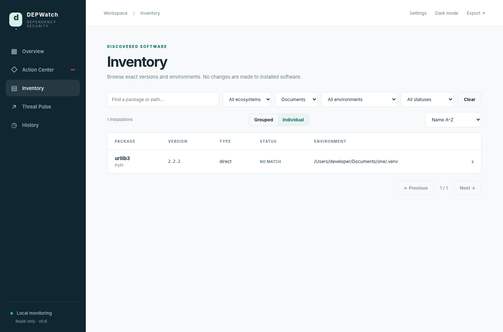

# LocDepIntel

**Local dependency intelligence.** Find every Python virtual environment and npm project on your machine, build a live inventory of the exact package versions installed, and get alerted when one of them matches a known **malicious package** or **vulnerability** advisory.

[](https://github.com/gerard-majella/locdepintel/actions/workflows/ci.yml)




## Why

Supply-chain attacks (typosquats, hijacked maintainer accounts, malicious post-install scripts) land on developer laptops first. Most SCA tools scan one repository in CI. Your laptop has dozens of forgotten virtualenvs and `node_modules` folders that nobody scans. LocDepIntel answers one question: **"Is anything installed on this machine right now named in a malware or vulnerability advisory?"**

## Features

- **Machine-wide discovery**: walks the folders you choose (bounded depth, no symlink following) and finds Python venvs (`pyvenv.cfg`) and npm projects (`package-lock.json` v1 to v3).
- **Exact-version matching** against [OSV.dev](https://osv.dev), including the OpenSSF malicious-packages feed (`MAL-` advisories).
- **Action Center**: findings grouped by package and version across every location, malware first.
- **Threat Pulse**: newest malware and reviewed advisories from the GitHub Advisory Database, cross-referenced with your inventory.
- **History**: every package first observed, removed, or newly flagged, stored in local SQLite.
- **Scheduled monitoring** (macOS launchd) with a desktop notification on new malware matches.
- **Zero runtime dependencies**: Python standard library only. Nothing to `pip install`, which means nothing in the tool itself to be supply-chain attacked.

## Security design

| Concern | How it is handled |
|---|---|
| Executing hostile code during a scan | Never. Reads `METADATA` text and lockfile JSON only. No imports, no `npm`/`pip` calls. |
| Malicious advisory text (stored XSS) | Escaped before rendering; strict CSP with no inline script. |
| DNS rebinding / cross-site requests to the local API | Loopback bind, `Host` allow-list, `Origin` check on every POST. |
| Command injection via "open in Terminal / reveal" | Only paths already in the scan database are accepted; arguments passed as argv, never through a shell. |
| Privacy | File paths stay local. Only package name + version go to OSV / deps.dev. Workspace-local npm packages are never sent. |
| False reassurance | Partial scans, unreachable roots and failed advisory checks are reported, and never mark the machine as clean. |

See [SECURITY.md](SECURITY.md) for the threat model and how to report issues.

## Quick start

Requires Python 3.10+.

```bash
git clone https://github.com/gerard-majella/locdepintel.git
cd locdepintel
python3 -m locdepintel serve        # Windows: py -3 -m locdepintel serve
```

Open http://127.0.0.1:8765, pick the folders to scan, and click **Start first scan**.

Or install it as a command:

```bash
pipx install git+https://github.com/gerard-majella/locdepintel.git
locdepintel serve
```

## CLI

| Command | What it does |
|---|---|
| `locdepintel scan [--offline]` | Discover environments and check them against OSV |
| `locdepintel roots ~/code ~/work` | Set which folders to scan |
| `locdepintel alerts` | Print active findings |
| `locdepintel inventory` | Print every installed package |
| `locdepintel export > report.json` | Full JSON export |
| `locdepintel pulse-sync` | Refresh Threat Pulse from GitHub Advisories |
| `locdepintel schedule --hours 6` | Register a periodic check (macOS) |

## Limitations

- Supports Python venvs and npm lockfiles. Not yet: Yarn, pnpm, Poetry/uv lockfiles, conda, Cargo, Go.
- "No findings" means no **published** advisory matches, not that the code is safe.
- Advisory checks need internet access; inventory works offline.
- Scheduling is macOS-only for now.

## Running tests

```bash
python3 -m unittest discover -s tests -v
```

Tests run fully offline using fixtures.

## Roadmap

- Per-session API token so other local users cannot query the loopback API
- Yarn / pnpm / `uv.lock` / `poetry.lock` parsers
- SARIF and CycloneDX SBOM export
- Linux (systemd timer) and Windows (Task Scheduler) scheduling

## License

MIT
